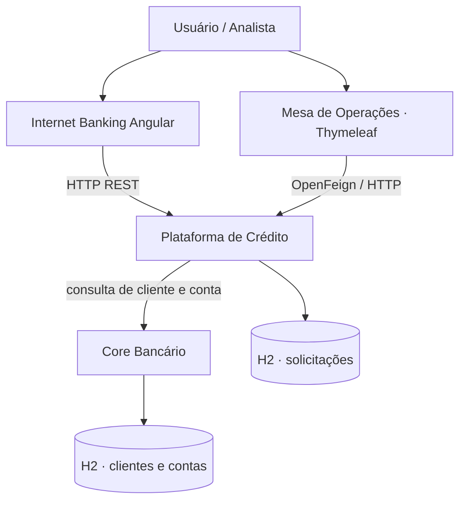
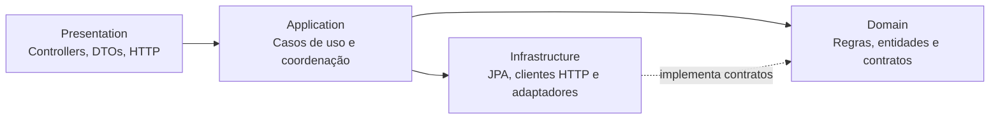
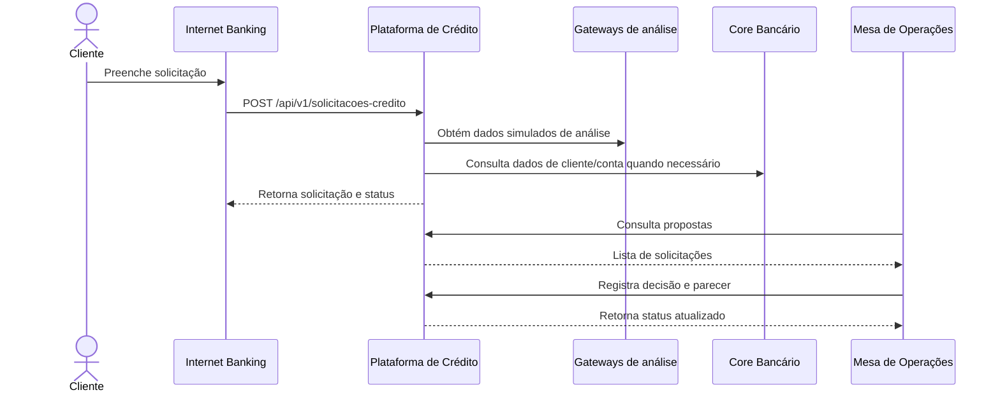
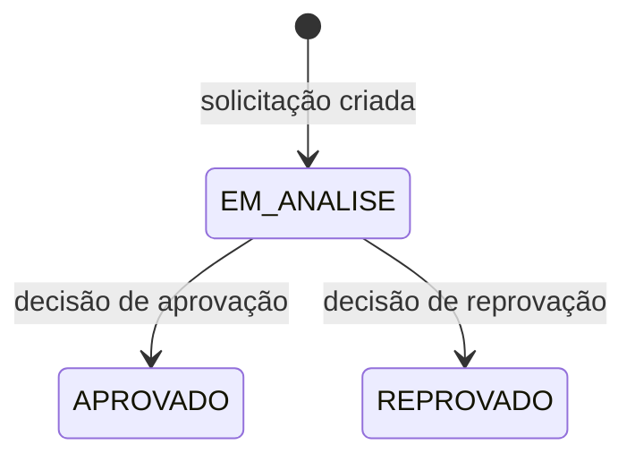

<div align="center">

# FIAP Bank
### Plataforma de Crédito · Checkpoint 5

**Uma solução acadêmica para representar o fluxo de solicitação, análise e decisão de crédito.**


[Visão geral](#-visão-geral) · [Arquitetura](#-arquitetura) · [Fluxo de crédito](#-como-o-processo-funciona) · [Executar](#-como-executar) · [API](#-api-principal) · [Validar](#-checklist-de-validação)

</div>

---

## 🧭 Navegação

- [1. Visão geral](#-visão-geral)
- [2. Componentes](#-componentes-do-sistema)
- [3. Arquitetura](#-arquitetura)
- [4. Processo de crédito](#-como-o-processo-funciona)
- [5. Tecnologias](#-tecnologias)
- [6. Como executar](#-como-executar)
- [7. API principal](#-api-principal)
- [8. Validação e solução de problemas](#-checklist-de-validação)
- [9. Estrutura do repositório](#-estrutura-do-repositório)
- [10. Integrantes](#-integrantes)

## 🏦 Visão geral

O **FIAP Bank** reúne componentes de um cenário bancário acadêmico com foco na jornada de crédito. A solução separa as responsabilidades de cadastro e contas bancárias, gestão das solicitações de crédito, análise operacional e interface web.

O projeto foi desenvolvido a partir do código inicial e dos requisitos fornecidos para o Checkpoint 5. Este README descreve a estrutura presente neste repositório e os procedimentos para executar e verificar os serviços.

> [!IMPORTANT]
> **Situação da validação:** a estrutura dos arquivos Maven e os módulos de domínio foram verificados, mas a compilação completa com Maven e os testes integrados ainda precisam ser executados em um ambiente com JDK 21, Maven e acesso às dependências. Consulte o [checklist](#-checklist-de-validação) antes de considerar a aplicação validada.

## 🧩 Componentes do sistema

| Componente | Responsabilidade | Porta local |
|---|---|---:|
| **Core Bancário** | Cadastro de clientes, contas e operações de saldo | `8080` |
| **Plataforma de Crédito** | Criação, consulta e decisão de solicitações de crédito | `8081` |
| **Mesa de Operações** | Interface para analistas acompanharem e decidirem propostas | `8082` |
| **Internet Banking Mobile** | Interface Angular para interação com as funcionalidades de crédito | `4200` |

<details>
<summary><strong>O que cada componente faz?</strong></summary>

- **Core Bancário:** expõe recursos REST para clientes e contas. A camada de apresentação recebe as requisições, a aplicação coordena os casos de uso e a infraestrutura realiza a persistência.
- **Plataforma de Crédito:** mantém as solicitações e suas transições de status. Possui contratos para comunicação com serviços externos e integração com o Core.
- **Mesa de Operações:** aplicação web renderizada com Thymeleaf. Consome a Plataforma de Crédito para exibir propostas e registrar o parecer do operador.
- **Internet Banking Mobile:** aplicação Angular que oferece a interface do usuário e consome os endpoints de crédito configurados no projeto.

</details>

## 🏗️ Arquitetura

O Core Bancário e a Plataforma de Crédito são organizados em quatro módulos Maven. A separação ajuda a manter regras de negócio afastadas de detalhes de framework, transporte HTTP e persistência.



### Camadas internas



| Módulo | Papel | Exemplos neste projeto |
|---|---|---|
| `domain` | Regras e conceitos do negócio, sem dependência direta de Spring/JPA | `Cliente`, `Conta`, `SolicitacaoCredito`, interfaces de repositório e gateways |
| `application` | Orquestra os casos de uso e define DTOs de aplicação | `BankService`, `CreditoApplicationService` |
| `infrastructure` | Conecta o sistema a banco de dados e serviços externos | Adaptadores JPA, Spring Data e cliente Feign |
| `presentation` | Expõe endpoints, valida entradas e traduz erros HTTP | Controllers REST, DTOs de entrada e tratamento global de exceções |

<details>
<summary><strong>Por que separar as camadas?</strong></summary>

1. As regras de negócio podem ser lidas sem precisar entender detalhes do Spring ou do banco.
2. Os contratos de repositório e gateways permitem que a aplicação dependa de abstrações.
3. A infraestrutura pode trocar ou adaptar integrações sem colocar chamadas HTTP dentro das entidades de domínio.
4. A camada de apresentação concentra protocolo HTTP, validação de entrada e formato de resposta.

</details>

## 🔄 Como o processo funciona

O fluxo abaixo representa a jornada prevista pela aplicação. Consultas externas como SCR e Bureau estão representadas por gateways/adaptadores do projeto; no contexto acadêmico, não devem ser confundidas com consultas reais a bases financeiras oficiais.



### Estados da solicitação



As decisões são destinadas às solicitações em análise. A transição deve ser validada pelo serviço de aplicação/domínio, evitando alterações incompatíveis com o estado atual.

## 🧰 Tecnologias

- **Java 21** e **Maven** para os serviços backend.
- **Spring Boot** para aplicações web e APIs REST.
- **Spring Data JPA** e **H2** para persistência de desenvolvimento.
- **Spring Cloud OpenFeign** na comunicação entre a Mesa e a Plataforma de Crédito, e nos pontos de integração configurados.
- **Thymeleaf** na Mesa de Operações.
- **Angular 17** no Internet Banking Mobile.
- **Bean Validation** para validar dados recebidos pela API.

## 🚀 Como executar

### Pré-requisitos

Instale e configure:

- JDK 21 (`java -version`)
- Apache Maven 3.9 ou superior (`mvn -version`)
- Node.js e npm compatíveis com o projeto (`node -v` e `npm -v`)

A primeira compilação precisa de conexão com a internet para baixar dependências Maven e npm.

### 1. Compilar os backends

Execute na raiz do projeto, em um terminal PowerShell:

```powershell
cd .\fiap-bank-core-bancario
mvn clean install

cd ..\fiap-bank-plataforma-credito
mvn clean install

cd ..\fiap-bank-mesa-operacoes-credito
mvn clean package

cd ..
```

Espere cada comando terminar. Se ocorrer falha, corrija o primeiro erro antes de iniciar os serviços seguintes.

### 2. Iniciar os serviços

Abra **um terminal por serviço** e mantenha-os em execução.

<details>
<summary><strong>Core Bancário · porta 8080</strong></summary>

```powershell
cd .\fiap-bank-core-bancario\fiap-bank-core-bancario-presentation
mvn spring-boot:run
```

</details>

<details>
<summary><strong>Plataforma de Crédito · porta 8081</strong></summary>

```powershell
cd .\fiap-bank-plataforma-credito\fiap-bank-plataforma-credito-presentation
mvn spring-boot:run
```

</details>

<details>
<summary><strong>Mesa de Operações · porta 8082</strong></summary>

```powershell
cd .\fiap-bank-mesa-operacoes-credito
mvn spring-boot:run
```

</details>

<details>
<summary><strong>Internet Banking Angular · porta 4200</strong></summary>

```powershell
cd .\fiap-bank-internet-banking-mobile
npm install
npm start
```

</details>

Depois que os serviços iniciarem, acesse:

- Internet Banking: <http://localhost:4200>
- Mesa de Operações: <http://localhost:8082>
- Core Bancário: <http://localhost:8080>
- Plataforma de Crédito: <http://localhost:8081>

> Os links locais só respondem enquanto o serviço correspondente estiver iniciado sem erros.

## 🔌 API principal

### Plataforma de Crédito

| Método | Endpoint | Uso |
|---|---|---|
| `POST` | `/api/v1/solicitacoes-credito` | Criar solicitação |
| `GET` | `/api/v1/solicitacoes-credito` | Listar solicitações |
| `GET` | `/api/v1/solicitacoes-credito?cpf={cpf}` | Filtrar solicitações por CPF |
| `GET` | `/api/v1/solicitacoes-credito/{id}` | Consultar uma solicitação |
| `PUT` | `/api/v1/solicitacoes-credito/{id}/decisao` | Registrar decisão |

<details>
<summary><strong>Exemplo: criar uma solicitação</strong></summary>

`POST http://localhost:8081/api/v1/solicitacoes-credito`

```json
{
  "cpfCliente": "12345678901",
  "nomeCliente": "Cliente de Exemplo",
  "tipoCredito": "PESSOAL",
  "valorSolicitado": 5000.00,
  "quantidadeParcelas": 24,
  "rendaMensal": 3500.00
}
```

O exemplo demonstra o formato esperado pelo DTO. Use dados fictícios em testes e confira a resposta efetiva do serviço em execução.

</details>

<details>
<summary><strong>Exemplo: registrar decisão</strong></summary>

`PUT http://localhost:8081/api/v1/solicitacoes-credito/1/decisao`

```json
{
  "decisao": "APROVADO",
  "parecer": "Renda e condições analisadas pelo operador."
}
```

A decisão só deve ser enviada para uma solicitação que esteja em análise. O identificador `1` é ilustrativo: substitua por um ID existente.

</details>

### Core Bancário

| Método | Endpoint | Uso |
|---|---|---|
| `GET` / `POST` | `/api/v1/clientes` | Listar ou cadastrar clientes |
| `GET` / `PUT` / `DELETE` | `/api/v1/clientes/{id}` | Consultar, atualizar ou remover cliente |
| `GET` | `/api/v1/clientes/cpf/{cpf}` | Buscar cliente por CPF |
| `GET` / `POST` | `/api/v1/contas` | Listar ou cadastrar contas |
| `GET` | `/api/v1/contas/{numero}` | Consultar conta |
| `GET` | `/api/v1/contas/cliente/{cpf}` | Consultar contas de um cliente |
| `PUT` | `/api/v1/contas/{numero}/saldo` | Realizar depósito ou saque |
| `DELETE` | `/api/v1/contas/{numero}` | Encerrar conta |

A Plataforma de Crédito também mantém rotas de compatibilidade em `/api/credito/**` para atender às interfaces existentes neste projeto.

## ✅ Checklist de validação

Use esta lista ao preparar a entrega. Marque os itens somente depois de executá-los de verdade.

- [ ] JDK 21 e Maven estão disponíveis no terminal.
- [ ] `mvn clean install` termina com `BUILD SUCCESS` no Core Bancário.
- [ ] `mvn clean install` termina com `BUILD SUCCESS` na Plataforma de Crédito.
- [ ] `mvn clean package` termina com `BUILD SUCCESS` na Mesa de Operações.
- [ ] `npm install` termina sem erros no Angular.
- [ ] Os quatro serviços iniciam nas portas documentadas.
- [ ] Os endpoints de clientes, contas e solicitações respondem como esperado.
- [ ] Uma solicitação pode ser criada, consultada e decidida pela Mesa.
- [ ] O fluxo integrado foi testado e os erros foram registrados/corrigidos.
- [ ] Os integrantes revisaram o código, os documentos e os nomes/RMs antes de entregar.

### Diagnóstico rápido

<details>
<summary><strong>O terminal diz que `mvn` não é reconhecido</strong></summary>

O Maven não está instalado ou não está no `PATH`. Confira a instalação com `mvn -version` em um terminal novo.

</details>

<details>
<summary><strong>Erro ao baixar dependências</strong></summary>

Verifique a conexão com a internet, as configurações de proxy e tente novamente. Não trate falha de download como erro de código sem olhar a primeira causa indicada pelo Maven.

</details>

<details>
<summary><strong>A Mesa abre, mas não carrega propostas</strong></summary>

Confirme se a Plataforma de Crédito está funcionando na porta `8081` e se a URL configurada para o Feign aponta para ela. Leia os logs dos dois serviços.

</details>

<details>
<summary><strong>O Angular não consegue chamar a API</strong></summary>

Confira se a API está ativa, se a URL configurada no frontend está correta e se as regras de CORS permitem a origem `http://localhost:4200`.

</details>

## 📁 Estrutura do repositório

```text
.
├── fiap-bank-core-bancario/
│   ├── fiap-bank-core-bancario-domain/
│   ├── fiap-bank-core-bancario-application/
│   ├── fiap-bank-core-bancario-infrastructure/
│   └── fiap-bank-core-bancario-presentation/
├── fiap-bank-plataforma-credito/
│   ├── fiap-bank-plataforma-credito-domain/
│   ├── fiap-bank-plataforma-credito-application/
│   ├── fiap-bank-plataforma-credito-infrastructure/
│   └── fiap-bank-plataforma-credito-presentation/
├── fiap-bank-mesa-operacoes-credito/
├── fiap-bank-internet-banking-mobile/
├── ANALISE_TECNICA_CP5.md
├── COMO_EXECUTAR_E_VALIDAR.md
└── RESPOSTAS_AVALIACAO_TEORICA.md
```

## 👥 Integrantes

> Preencha com os nomes completos e RMs reais do grupo antes de entregar. Não deixe os campos de exemplo no repositório final.

| Integrante | RM |
|---|---|
| Jean Carlos Rodrigues da Silva | RM 566439 |


## 📚 Documentação complementar

- [`ANALISE_TECNICA_CP5.md`](ANALISE_TECNICA_CP5.md): decisões técnicas e limitações conhecidas.
- [`COMO_EXECUTAR_E_VALIDAR.md`](COMO_EXECUTAR_E_VALIDAR.md): comandos detalhados para Windows e roteiro de validação.
- [`RESPOSTAS_AVALIACAO_TEORICA.md`](RESPOSTAS_AVALIACAO_TEORICA.md): respostas preparadas para a parte teórica do checkpoint.

---

<div align="center">

**FIAP Bank · Checkpoint 5**
*Projeto acadêmico. Não utilizar dados bancários reais nem tratar os gateways simulados como serviços financeiros oficiais.*

</div>
